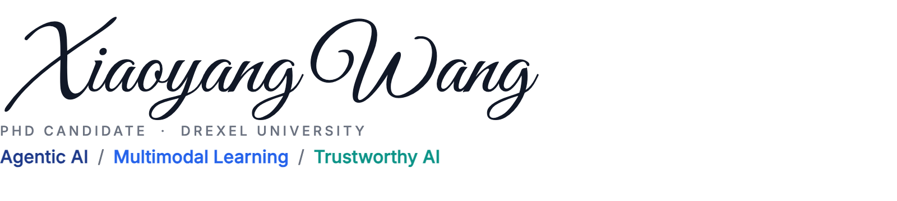

<picture>
  <source media="(prefers-color-scheme: dark)" srcset="assets/header-dark.png">
  
</picture>

  <a href="https://wangxiaoyang.me"><picture><source media="(prefers-color-scheme: dark)" srcset="assets/link-homepage-dark.png"></picture></a>
  <a href="https://scholar.google.com/citations?user=vGh4WZEAAAAJ"><picture><source media="(prefers-color-scheme: dark)" srcset="assets/link-scholar-dark.png"></picture></a>
  <a href="https://www.linkedin.com/in/xiaoyang-s-wang"><picture><source media="(prefers-color-scheme: dark)" srcset="assets/link-linkedin-dark.png"></picture></a>
  <a href="https://x.com/SynchronizedAbe"><picture><source media="(prefers-color-scheme: dark)" srcset="assets/link-x-dark.png"></picture></a>
  <a href="mailto:xw388@drexel.edu"><picture><source media="(prefers-color-scheme: dark)" srcset="assets/link-email-dark.png"></picture></a>
  <a href="https://orcid.org/0000-0002-8471-4670"><picture><source media="(prefers-color-scheme: dark)" srcset="assets/link-orcid-dark.png"></picture></a>

> [!NOTE]
> **I'm on the 2027 job market** (PhD expected Spring 2027), open to industry research scientist roles and academic postdoc / faculty positions in trustworthy and medical AI. Email is the best way to reach me: xw388@drexel.edu.

I'm a PhD candidate at Drexel University, advised by [Prof. Christopher C. Yang](https://cci.drexel.edu/faculty/cyang/). Clinical AI can be accurate on average yet still fail the patients who need it most, by being unfair, opaque or confidently wrong. My dissertation asks when multi-agent LLM systems in medicine deserve our trust: **when the agents agree, do they actually reason alike?**

- **Agentic AI**: multi-agent LLM systems for clinical reasoning, and when their consensus can be trusted
- **Multimodal learning**: robust patient models from whatever combination of modalities is available
- **Trustworthy AI**: clinical prediction that is fair, explainable and knows when to abstain

## Toolbox

<picture>
  <source media="(prefers-color-scheme: dark)" srcset="assets/toolbox-dark.png">
  
</picture>
